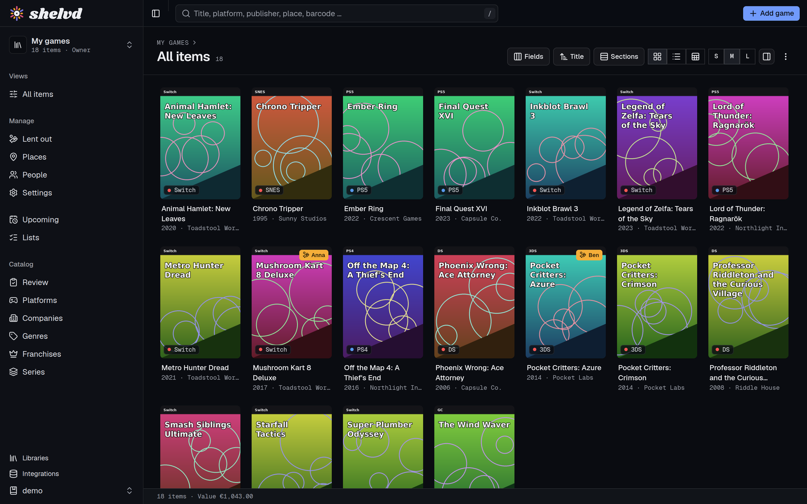
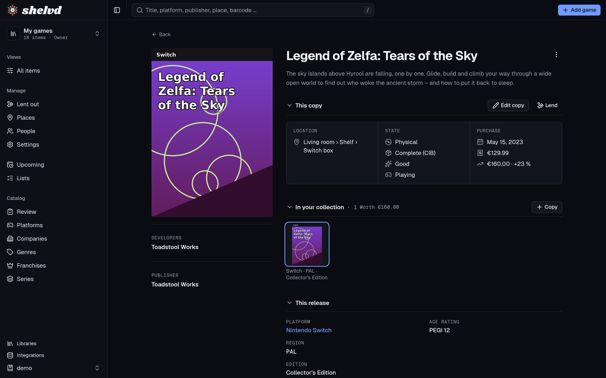

# shelvd

[](https://github.com/marank/shelvd/actions/workflows/build.yaml)
[](LICENSE)
[](https://github.com/marank/shelvd/pkgs/container/shelvd)

shelvd keeps track of your game collection – from NDS and 3DS to Switch and PS5, later DVDs
and Blu-rays too. You record which copies you own, where they stand and who borrowed them, sort
them into views of your own, and watch the games still to come until they arrive. Scan a
barcode with your phone and the game is in; let IGDB, HowLongToBeat and others fill in the
rest. It runs on your own server with Docker, in English and German.



<sub>Screenshots show made-up demo data: the titles are homages, the covers were drawn for this README.</sub>

## Features

### Your collection

- **Views of your own:** nest freely (platform › publisher › year), filter and sort by any
  field, save it as a view, show it as grid, list or table and browse it like folders.
- **Physical order:** places as a free tree (room › shelf › box), so you find the cartridge
  you're looking for.
- **Owners and loans:** who owns which copy, who borrowed what, and what is overdue.
- **Your copy, your way:** condition, completeness, play status, price and value per copy;
  your own title, cover or edition without changing the shared catalog.
- **Barcode scan** with the phone camera or a USB scanner; search across all fields including
  barcodes.

### One page per game

- **Game, release, copy on one page:** every release of a game, your copies of it, play times,
  scores, languages, the series it belongs to and where the data comes from.
- **A catalog to browse:** platforms, companies, genres, franchises and series have pages of
  their own, with logos and descriptions from Wikipedia and IGDB.



### Upcoming games

- **Watch, pre-order, bought:** release dates as precise as they are known (day, month,
  "Q3 2026", TBA), and one click takes a game into your library once it has arrived.

### Sharing

- **Members** with a role (view or edit), **public links** without an account, and lists of
  your own.

### Data from elsewhere

- **Integrations**, set up in the app: game data and covers from IGDB, play times from
  HowLongToBeat, scores from OpenCritic, more covers from TheGamesDB and ScreenScraper (see
  [docs/data-sources.md](docs/data-sources.md)). All are off until an admin turns them on.
- **Add-ons:** optional features can live in repositories of their own and plug in without
  changing shelvd.

### Operations and security

- **Roles:** only admins change the shared catalog – what others enter waits in a review
  queue; library owners decide who sees and edits what, and viewers never see prices or
  contact details.
- **Hardened container:** read-only, without capabilities, as an unprivileged user; nightly
  database backups; images for amd64 and arm64 with a provenance attestation.

## Quick start with Docker

You need Docker with the Compose plugin. shelvd runs from the published image
`ghcr.io/marank/shelvd`; the server needs only three files.

1. Download `compose.yml`, the backup script and the example configuration:

   ```bash
   mkdir -p shelvd/docker && cd shelvd
   curl -fsSLO https://raw.githubusercontent.com/marank/shelvd/main/compose.yml
   curl -fsSL https://raw.githubusercontent.com/marank/shelvd/main/docker/backup.sh -o docker/backup.sh
   curl -fsSL https://raw.githubusercontent.com/marank/shelvd/main/.env.example -o .env
   ```

2. Edit `.env` and set at least these values:

   | Variable | Value |
   | --- | --- |
   | `SECRET_KEY` | A random string of at least 40 characters. shelvd does not start with the placeholder. |
   | `ADMIN_PASSWORD` | Password of the first administrator (user `admin`). |
   | `DB_PASSWORD` | Password of the database, used only between the containers. |
   | `APP_URLS` | The address users open, e.g. `http://shelvd.example.com:8080`. Keep `http://localhost:8080` to try it on your own machine. |

   Generate the random values for `SECRET_KEY` and `DB_PASSWORD` with
   `openssl rand -hex 32`.

3. Start shelvd and its database:

   ```bash
   docker compose up -d
   ```

Open <http://localhost:8080> and sign in as `admin`. Updates:
`docker compose pull && docker compose up -d`; migrations run on every start.

## Operations

- **TLS:** put a TLS proxy in front, use `https://` URLs in `APP_URLS` and set
  `TRUSTED_PROXIES` to the proxy's address.
- **Settings:** every variable is explained in [`.env.example`](.env.example).
- **Backups:** the `backup` service dumps the database nightly into the `backups` volume;
  covers live in the `app-data` volume. Details in [docs/operations.md](docs/operations.md).

## Contributing

shelvd is still in active development, so pull requests are not accepted yet; bug reports
and ideas are welcome as issues. See [CONTRIBUTING.md](CONTRIBUTING.md).
To run shelvd from source (setup and checks in [docs/development.md](docs/development.md)):

```bash
cp .env.example .env && just setup && just migrate
just dev-backend     # second terminal: just dev-frontend → http://localhost:8080
```

## License

[GNU Affero General Public License v3.0 or later](LICENSE). Running a modified shelvd for
others over a network obliges you to offer them its source.
